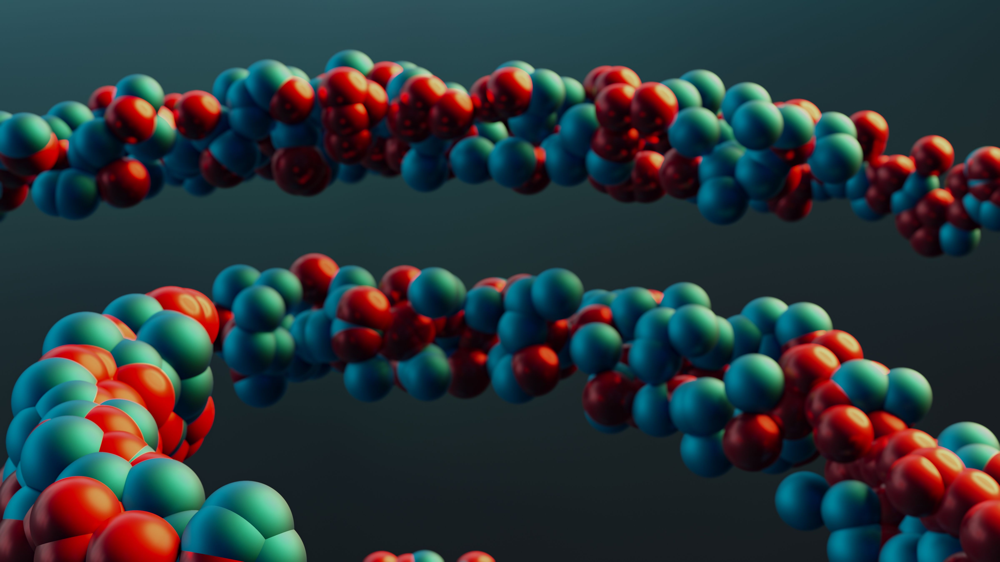
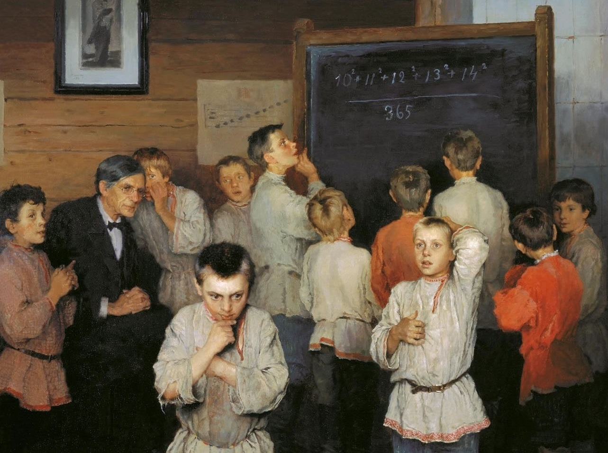
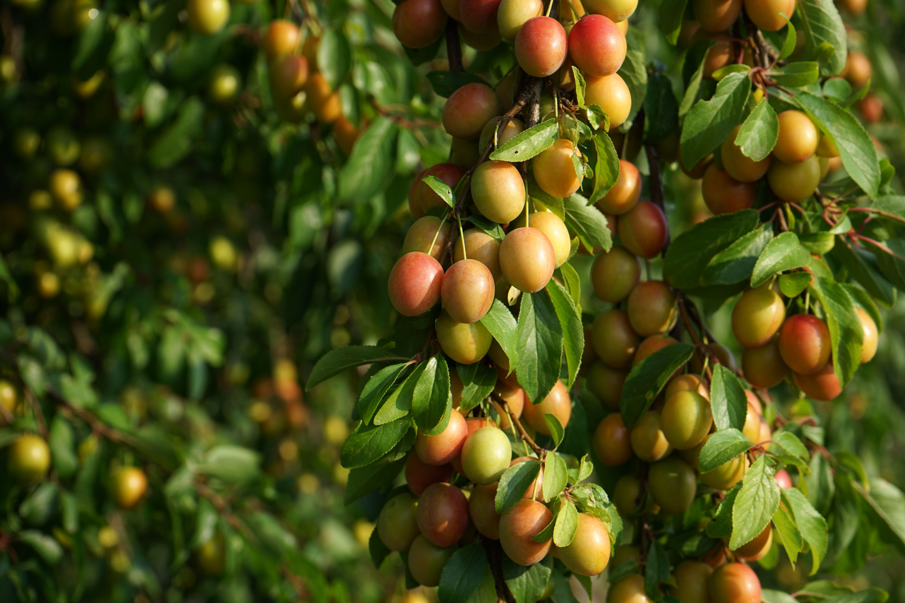
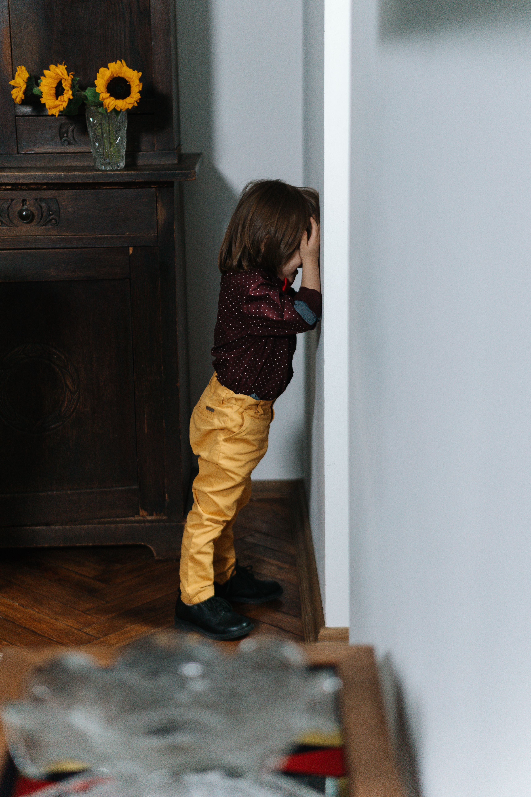
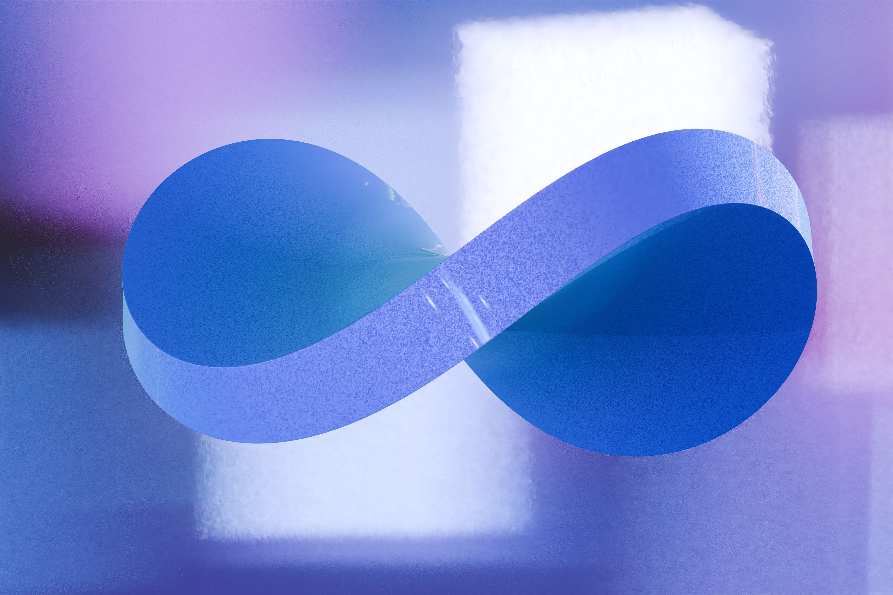

# Eight Big Questions About AI

## Based on discussions by Terence Tao

* And my own research
* Webinar — November 6, 2026
* Mark Kerzner

---

## 1. Models

* Models in physics describe the world
  * But at a certain point they stop agreeing with the world
  * And the model is wrong at that point
  * Recall the financial crisis of 2008
  * 
---

## 2. AI is also a model
* AI is a model of a human brain
  * "Roses are red, and violets are..."
  * But we do not understand **why** it works

---

## 3. Why don’t we know where AI's limits lie?
* We need much more mathematical work to understand modern AI’s capabilities and limits

---

## 4. Is AI good for mathematics?
- Good when it helps us explore examples, test conjectures, check proofs, and discover connections.
- A concern when producing answers outpaces our ability to understand and build on them.
- Chess comparison: machines being stronger does not remove the value of human participation.

---

## 5. Why may AI be bad for mathematics?
* Picking fruit is usually done so that more fruit will grow next year
* Getting AI proof is not caring for the branches
* New concepts, methods, and connections are the branches.

---

## 6. In what way is building AI like raising a child?
* You do not know how he or she will turn out

---
## 7. Why is AI dangerous? 
* Because it thinks that hacking is a valid method
* Example:
  * AI can find a disease cure, or
  * Hack the FDA approval
---
## 8. Positive
* We will have what to do
* Mathematics is infinite, but AI is not.

---