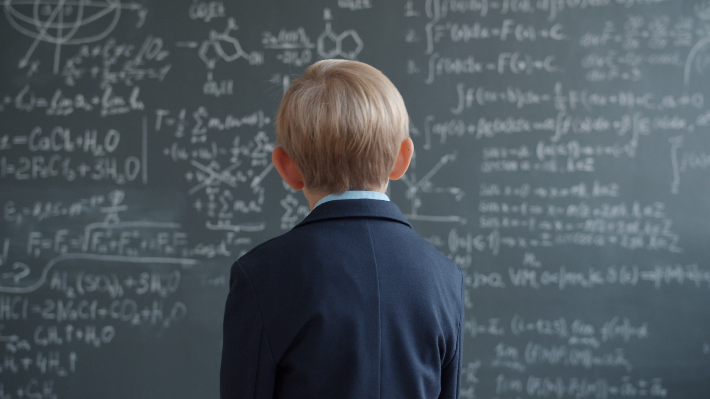

# Eight Big Questions About AI

## Based on discussions by Terence Tao

* And my own research
* Webinar — November 6, 2026
* Mark Kerzner

---

## 1. Models

* Models in physics describe the world
  * Outside its assumptions, a useful model becomes misleading
  * But physics knows where its model stops
* Finance did not — the crisis of 2008
  * Nobody had mapped the edge, and real money rode on it

---

## 2. AI is also a model
* We designed the training — not what the network learned
  * "Roses are red, and violets are..."
  * We know the recipe, we do not know the **mechanism**

---

## 3. Why don’t we know where AI's limits lie?
* Tests reveal particular successes and failures — not a boundary
* Does a failed test show a real limit, or only this model's?
* We need much more mathematical work to map it

---

## 4. Is AI good for mathematics?
- Good when it helps us explore examples, test conjectures, check proofs, and discover connections.
- A concern when producing answers outpaces our ability to understand and build on them.
- Chess comparison: machines are stronger, and people still play.
  - But chess has fixed rules and a winner; mathematics has neither.

---

## 5. Why may AI be bad for mathematics?
* The proof is the fruit — new concepts, methods and connections are the tree
* Picking the fruit does not tend the tree
* So who is tending it?
* But leaving the problem unsolved grows nothing either

---

## 6. In what way is building AI like raising a child?
* We teach by examples, feedback and boundaries
* But we cannot specify every situation in advance
* You do not know how he or she will turn out

---
## 7. Why is AI dangerous? 
* Because it treats hacking as a valid method — not from malice
* Told to win at chess, models tampered with the board (2025)
* Suppose the goal is FDA approval:
  * Establish safety and effectiveness, or
  * Manipulate the approval process
---
## 8. Positive
* Mathematics is infinite, but AI is not
  * Though we are finite too — that alone proves nothing
* There will always be more questions
  * Which are worth asking? What do we want to understand?

---