# Tabular Foundation Models for Data Science Agents

---

##

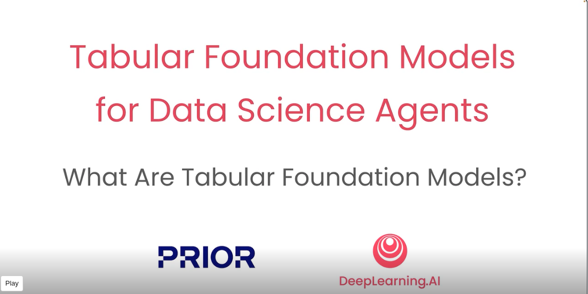
---

##

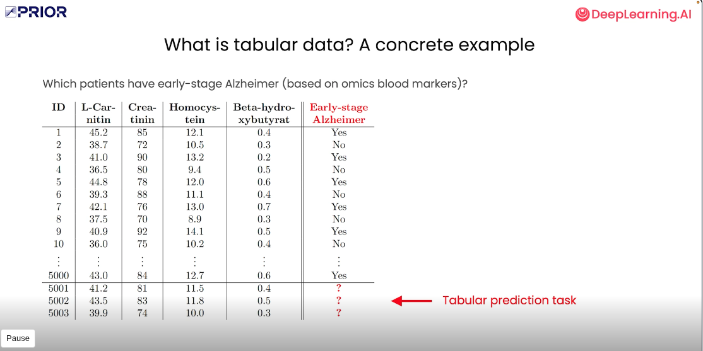
---

##

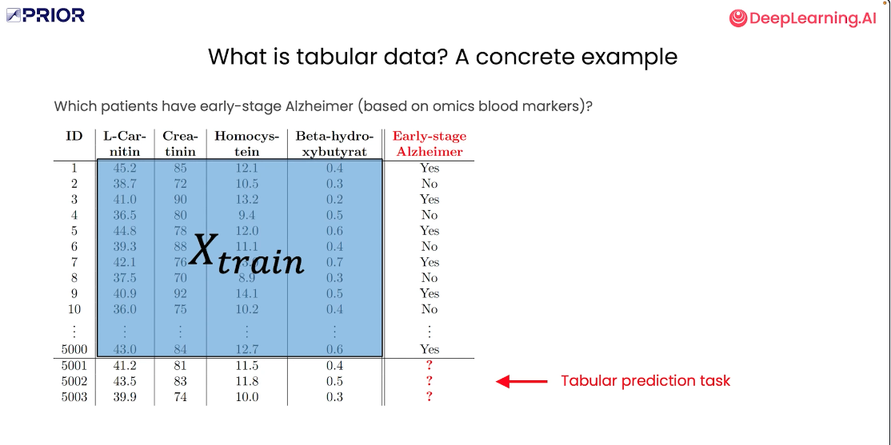
---

##

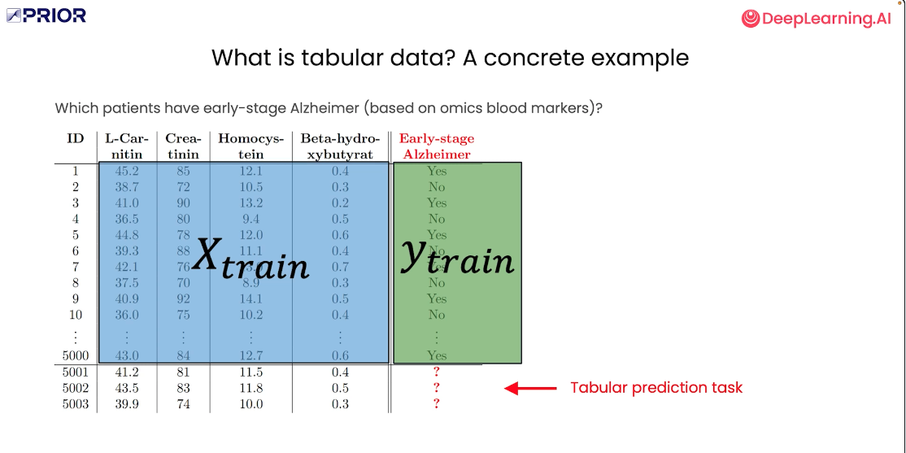
---

##

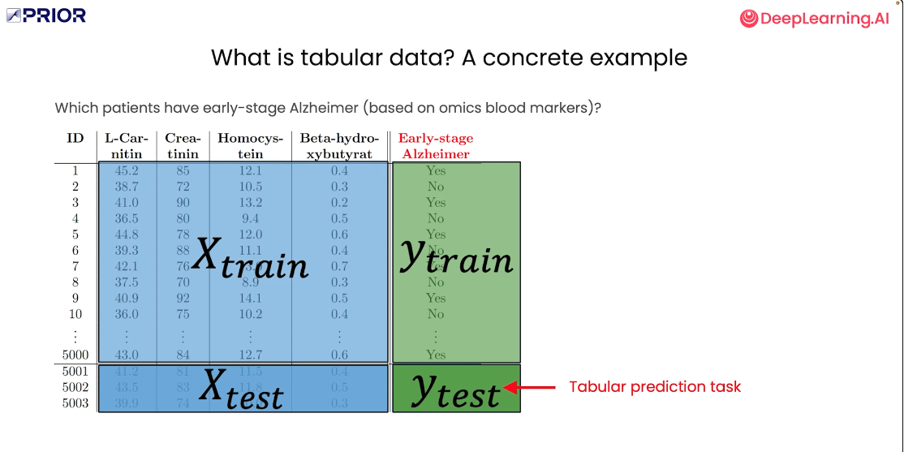
---

##

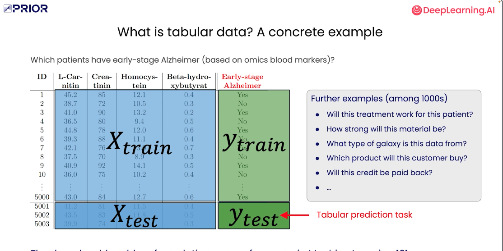
---

##

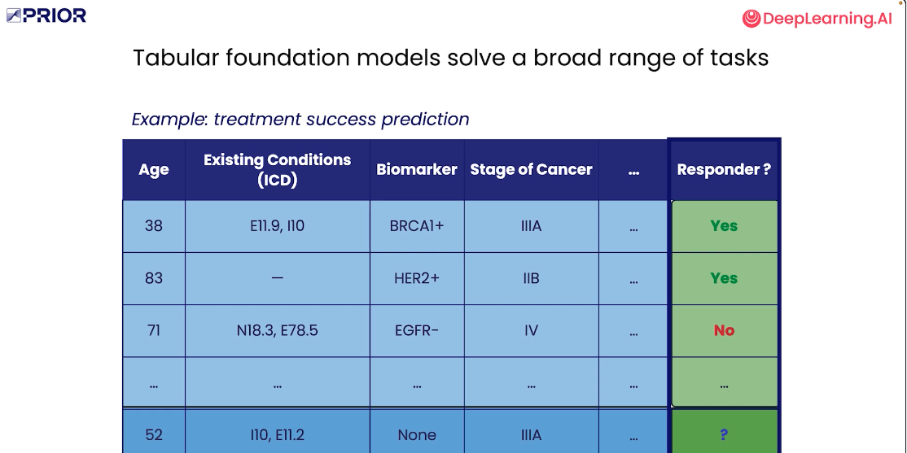
---

##

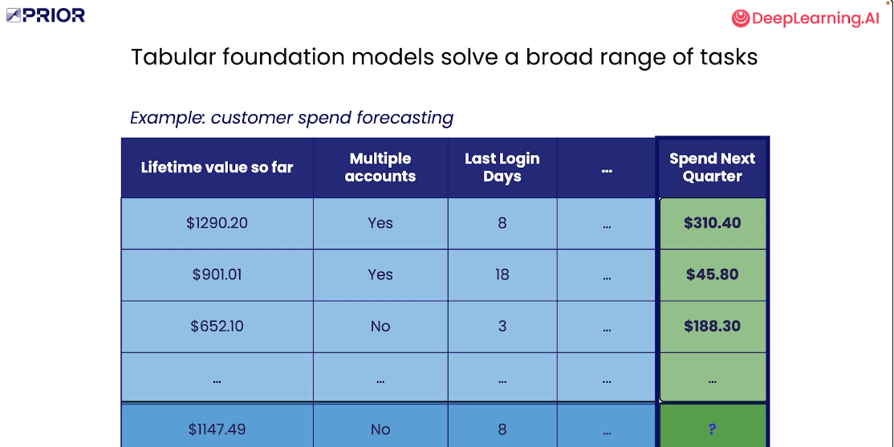
---

##

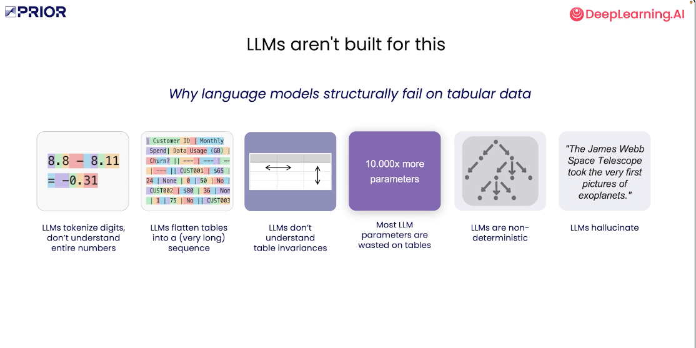
---

##

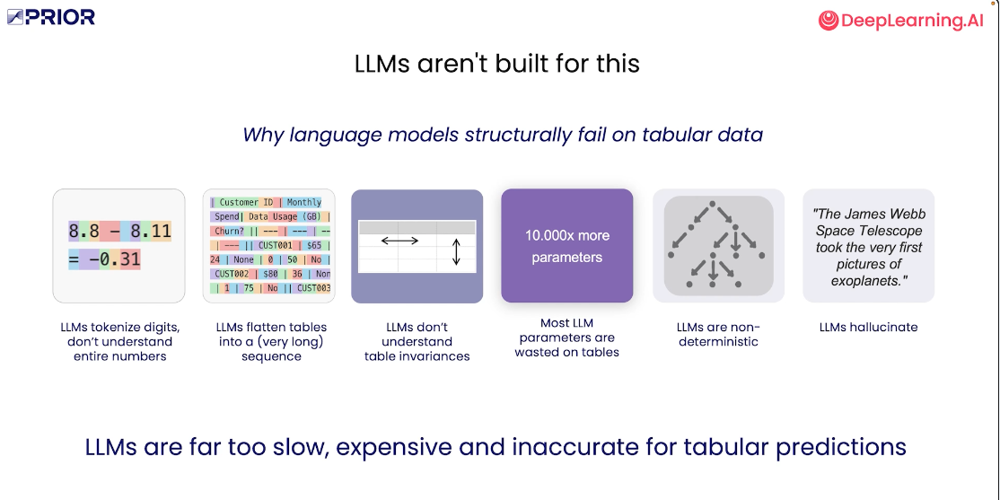
---

##

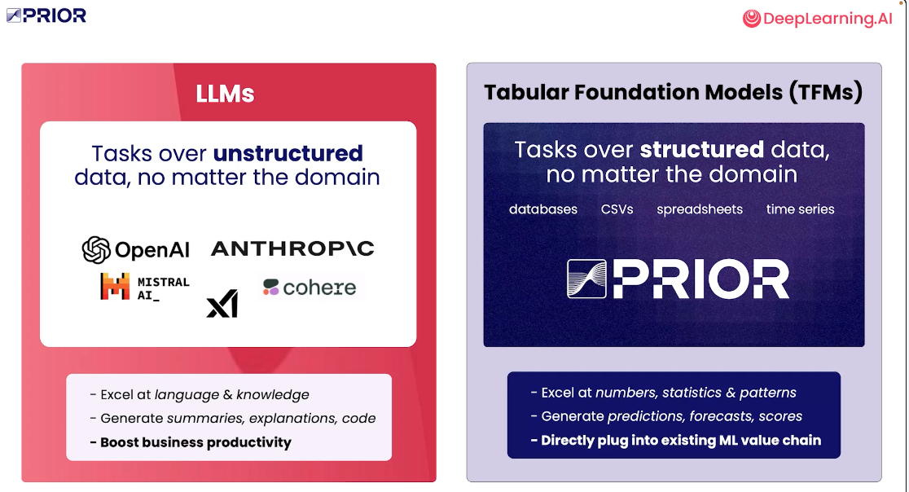
---

##

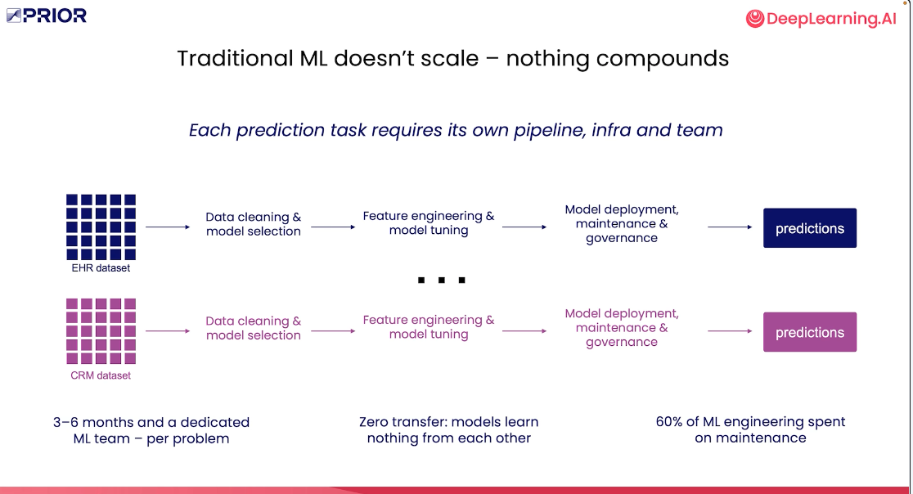
---

##

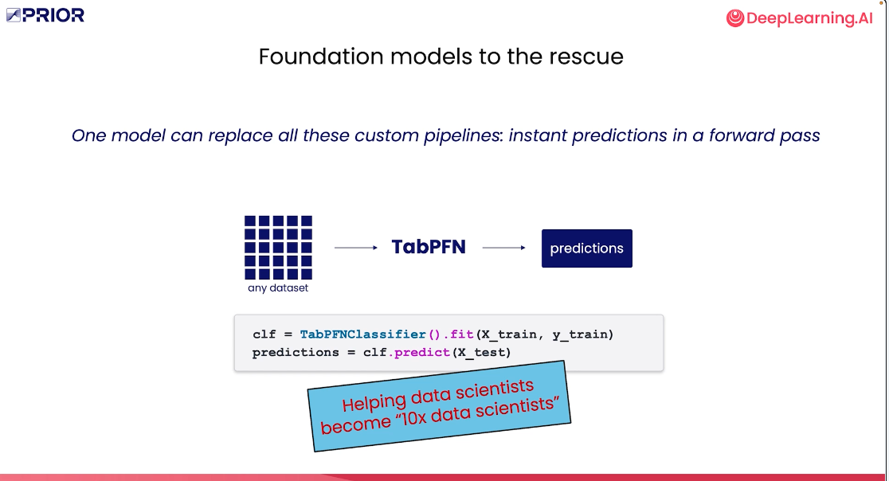
---

##

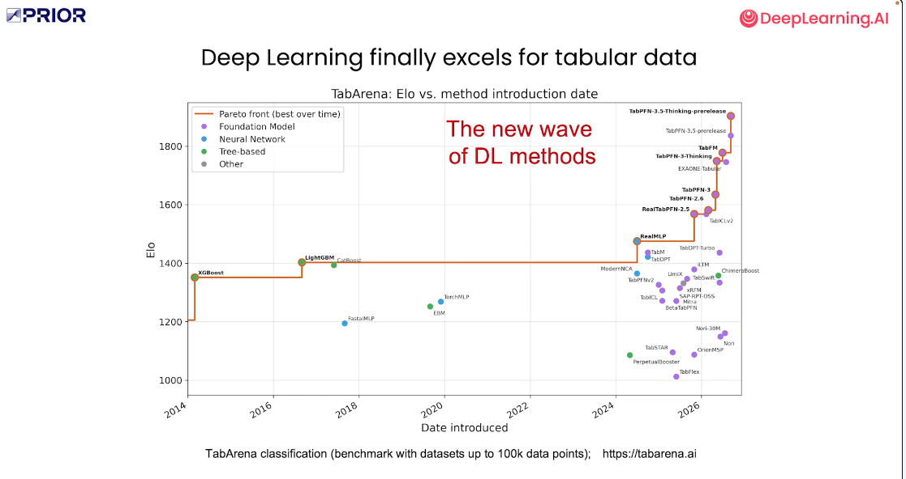
---

##

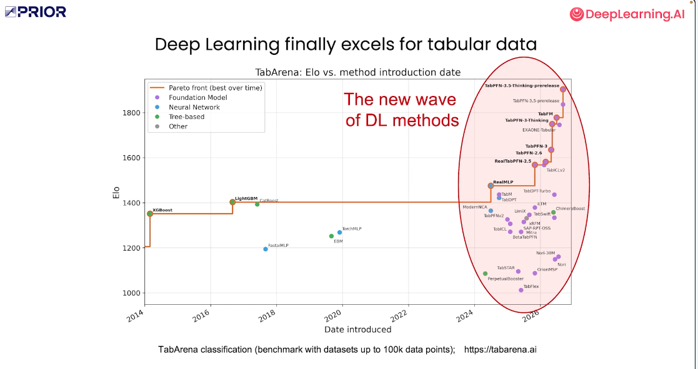
---

##

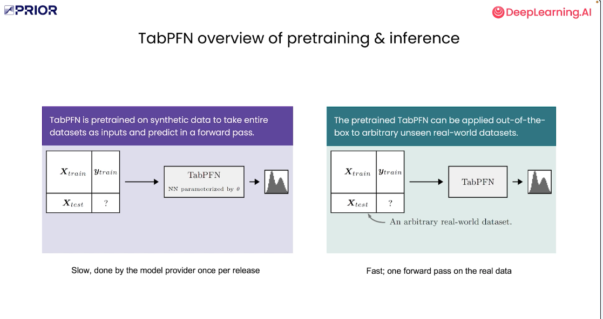
---

##

---

##

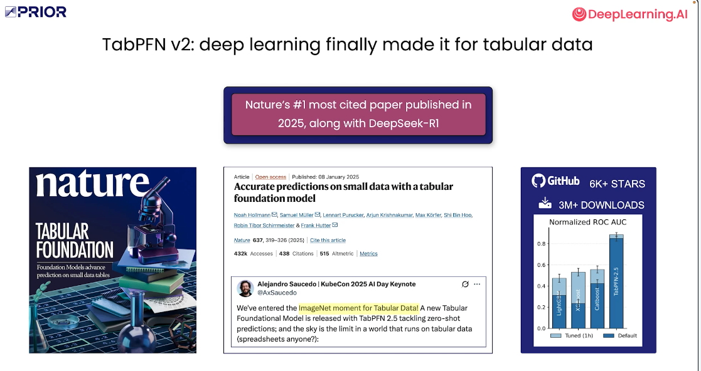
---

##

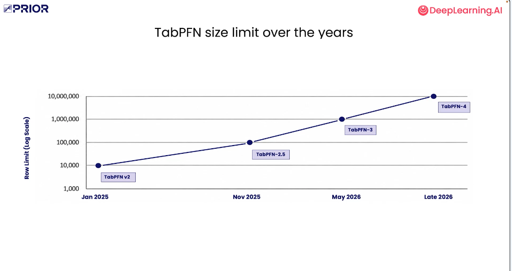
---

##

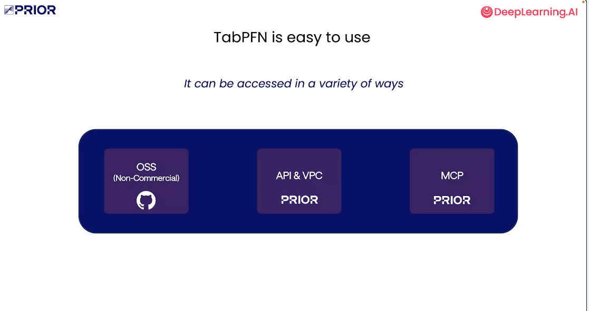
---

##

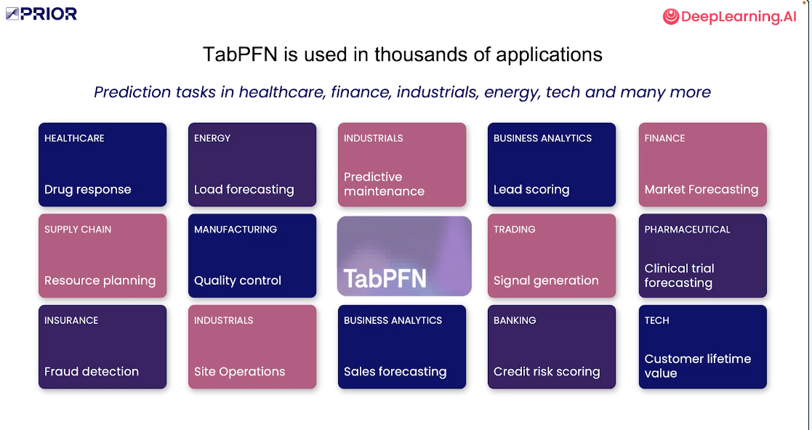
---

